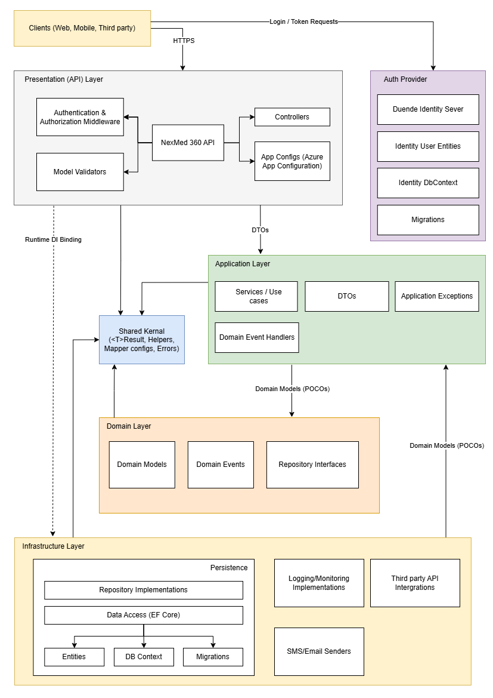
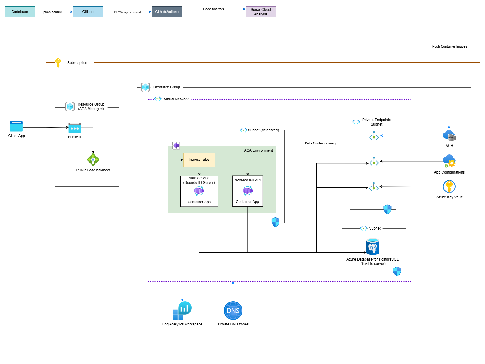

# 1. Architectural Overview & Philosophy

The NexMed 360 backend is built on a Clean Architecture (CA) foundation, enforced by Domain-Driven Design (DDD) tactical patterns. This approach ensures maximum maintainability, testability, and stability for a complex healthcare application.

## 1.1. Core Architectural Principles

<table style="border: 1px solid #007ec2ff">
    <tr style="background-color: #007ec2ff">
        <th>Principle</th>
        <th>Description</th>
        <th>Justification</th>
    </tr>
    <tr>
        <td>Dependency Rule (CA)</td>
        <td>Source code dependencies must only point inward <code>(API → Application → Domain)</code>. No inner layer may know about the outer layers.</td>
        <td>Guarantees the core business logic (Domain) is completely decoupled from external technology (EF Core, Web Frameworks).</td>
    </tr>
    <tr>
        <td>Single Source of Truth (DDD)</td>
        <td>The Domain Model is the exclusive source of business rules (invariants) and object state.</td>
        <td>Prevents scattered logic; ensures all rules are enforced centrally.</td>
    </tr>
    <tr>
        <td>Separation of Concerns (SOLID)</td>
        <td>Application is split into logical and physical projects, each with a single, clear responsibility.</td>
        <td>Maximizes testability and scalability, allowing independent development and deployment considerations.</td>
    </tr>
    <tr>
        <td>Persistence Ignorance</td>
        <td>The Domain layer contains zero references or knowledge of how data is saved.</td>
        <td>The Domain is designed for the business problem, not the database structure.</td>
    </tr>
</table>

## 1.2. Tech Stack and Infrastructure

- **Framework:** `.NET 10 (ASP.NET Core)`
- **ORM:** `Entity Framework Core (EF Core)`
- **Containerization:** `Docker`
- **Database:** `Postgre SQL`
- **CI/CD:** `GitHub Actions`
- **Hosting Infrastructure:** `Azure App Services | Azure Container Apps`
- **Documentation:** `Swagger / OpenAPI`
- **Json Serialization:** `System.Text.Json`

</br>

# 2. Project Structure and Responsibilities

The architecture is implemented using four physical projects. Dependencies must strictly adhere to the inward rule.

<table style="border: 1px solid #007ec2ff">
    <tr style="background-color: #007ec2ff">
        <th>Project</th>
        <th>Name (.csproj)</th>
        <th>Dependencies (Points To)</th>
        <th>Core Responsibilities</th>
    </tr>
    <tr>
        <td>Domain</td>
        <td><code>NexMed360.Domain</code></td>
        <td>None</td>
        <td>Business Rules: Defines Entities, Value Objects, Domain Events, and Repository Interfaces (Contracts).</td>
    </tr>
    <tr>
        <td>Application</td>
        <td><code>NexMed360.Application</code></td>
        <td><code>NexMed360.Domain</code></td>
        <td>Use Cases & Policies: Contains Specifications, Handlers, DTOs, and Application Contracts (e.g., <code>IEmailSender</code>, <code>IDomainEventDispatcher</code>).</td>
    </tr>
    <tr>
        <td>Infrastructure</td>
        <td><code>NexMed360.Infrastructure</code></td>
        <td><code>NexMed360.Application</code></td>
        <td>Implementations: Contains EF Core Data Models, Concrete Repository implementations, UnitOfWork implementation, and external service implementations (e.g., <code>SmtpEmailSender</code>).</td>
    </tr>
    <tr>
        <td>Presentation</td>
        <td><code>NexMed360.API</code></td>
        <td><code>NexMed360.Infrastructure</code></td>
        <td>Entry Point: Controllers, Dependency Injection Setup, HTTP Routing, Authentication/Authorization Filters, and Error Handling Middleware.</td>
    </tr>
</table>

## 2.1. Application Architecture Diagram


</br>

# 3. Domain-Driven Design (DDD) Patterns

These patterns ensure the domain is rich, robust, and maintains transactional integrity.

## 3.1. Entities and Value Objects (VOs)

<table style="border: 1px solid #007ec2ff">
    <tr style="background-color: #007ec2ff">
        <th>Pattern</th>
        <th>Purpose</th>
        <th>Implementation Guide</th>
    </tr>
    <tr>
        <td>Entity <code>(Patient, Appointment)</code></td>
        <td>Object with identity <code>(Guid Id)</code>. Inherits from <code>EntityBase</code>. Used for core business objects tracked over time.</td>
        <td>Must use private/protected setters. State changes must occur via public, meaningful methods <code>(patient.UpdateAddress(newAddress))</code>.</td>
    </tr>
    <tr>
        <td>Value Object <code>(Address, Money)</code></td>
        <td>Object defined purely by its attributes. Immutable and lacks identity. Inherits from <code>ValueObjectBase</code>.</td>
        <td>Must be immutable. New state requires creating a new instance. Used for descriptive data that should be treated as a single unit.</td>
    </tr>
</table>

## 3.2. Aggregates and Aggregate Roots (AR)

- **Definition:** An Aggregate is a transactional boundary. The Aggregate Root (AR) is the single Entity that controls access to all objects within that boundary.

- **Example:** Appointment is the AR; Treatment is an internal/child Entity.

- **Rules Enforcement:** The AR is the gatekeeper. All invariants (business rules) that apply across the entire aggregate (e.g., "Cannot modify a confirmed appointment") are checked and enforced by the AR's methods.

- **Implementation:** The AR tracks all Domain Events in a transient list.

## 3.3. Domain Events

- **Definition:** An object representing an immutable fact that occurred in the domain (e.g. `AppointmentCompletedEvent`).

- **Flow & Implementation:**

  - AR method (`appointment.Complete()`) calls `AddDomainEvent(event)`.

  - The Unit of Work (in the Infrastructure layer) intercepts the AR's list of events before `SaveChangesAsync()`.

  - The UoW dispatches the events via the Event Dispatcher (an Application contract) to the relevant Application Handlers.

  - Handlers perform decoupled side effects (e.g., sending emails).

</br>

# 4. Persistence and Transaction Management

## 4.1. Model Separation: Domain vs. Data

<table style="border: 1px solid #007ec2ff">
    <tr style="background-color: #007ec2ff">
        <th><p><strong>Model</strong></p></th>
        <th><p><strong>Project</strong></p></th>
        <th><p><strong>Purpose &amp; Role</strong></p></th>
    </tr>
    <tr>
        <td><p><strong>Domain Model</strong></p></td>
        <td><p><code>NexMed360.Domain</code></p></td>
        <td><p><strong>Rich</strong> object model. Contains collections (<code>List&lt;Prescription&gt;</code>) and private setters.</p></td>
    </tr>
    <tr>
        <td><strong>Data Model  (Entity)</strong></p></td>
        <td><code>NexMed360.Infrastructure</code></p></td>
        <td><p><strong>Anemic</strong> object model. Contains public setters for EF Core mapping. Flat structure for database  columns.</p></td>
    </tr>
</table>

> Translator: The Repository Implementation is responsible for converting the Data Model retrieved from the database into the rich Domain Model expected by the Application layer.

## 4.2. Repository Pattern

- **Interface (`IRepository`):** Defined in `NexMed360.Domain`.

- **Implementation:** Lives in `NexMed360.Infrastructure`. Injects the shared `NexMedDbContext` instance.

## 4.3. Unit of Work (UoW)

- **Interface (`IUnitOfWork`):** Defined in `NexMed360.Domain`. Contains `CommitAsync()`.

- **Implementation:** Lives in `NexMed360.Infrastructure`. Wraps the shared `NexMedDbContext` instance.

- **Critical Role:** Ensures atomicity. `CommitAsync()` is the central point where:

    - Domain Events are collected and dispatched.

    - `context.SaveChangesAsync()` is called, committing all pending changes (across all Repositories) in a single database transaction.

</br>

# 5. Application and Presentation Layer Details

## 5.1. Application Layer (Services and Handlers)

- **Structure:** Uses the repository pattern. Handlers inject Repositories and the UoW.

- **Decoupling Side Effects:** Handlers for Domain Events (e.g., `SendAppointmentConfirmationHandler`) reside here, defining the application's policy in response to a business fact. They depend only on Application Contracts (like `IEmailSender`).

## 5.2. Dependency Inversion Principle (DIP) for External Services

- **Contract:** The interface (e.g., `IEmailSender`, `ISmsSender`) is defined in the Application project (the inner layer).

- **Implementation:** The concrete service (e.g., `SmtpEmailSender`, `TwilioSmsSender`) is implemented in the Infrastructure project (the outer layer).

- **Benefit:** Allows swapping external services (e.g., changing from Twilio to Vonage) without altering the core business policies in the Application or Domain layers.

## 5.3. Error Handling and API

- **Api Response:** All Api endpoints should strictly respond using a standard `Result<T>` class. refer the code below.
```
public class Result<T>
{
    public bool IsSuccess { get; set; }
    public ApiError? Error { get; set; }
    public T? Data { get; set; }

    public static implicit operator Result<T>(T? data) => new()
    {
        IsSuccess = true,
        Data = data
    };

    public static implicit operator Result<T>(ErrorCode errorCode) => new()
    {
        IsSuccess = false,
        Error = ErrorRegistry.GetError(errorCode)
    };

    public static implicit operator Result<T>(ApiError apiError)
    {
        var errorCode = apiError.Code ?? ErrorCode.UnknownError;
        var baseError = ErrorRegistry.GetError(errorCode);
        var title = apiError.Title ?? baseError.Title;
        var httpStatus = apiError.HttpStatus ?? baseError.HttpStatus;
        var description = apiError.Description ?? baseError.Description;
        
        return new Result<T>
        {
            IsSuccess = false,
            Error = new(errorCode, title, description, httpStatus),
        };
    }
}
```
- **Error Flow:** Custom Application errors are used.

    - **class `ApiError`:** Contains error specific details (e.g., error code, title, descriptions, http status).

    - **class `ErrorRegistry`:** Holds a collection of pre-defined ApiErrors with specific details.

- **API Middleware:** The `NexMed360.API` project must implement global Exception Handling Middleware to intercept all custom exceptions and translate them into appropriate HTTP status codes with a standardized `Result<T>` JSON payload.

</br>

# 6. Deployment Architecture
The system is designed as a cloud native application to be hosted on Microsoft Azure.



As illustrated in the Deployment architecture diagram above, the deployment pipeline
and runtime environment consist of:
- **CI/CD Pipeline:** Developers push code to GitHub, triggering GitHub Actions.
This pipeline runs unit tests, performs code analysis via SonarCloud, builds
Docker container images, and pushes them to the Azure Container Registry
(ACR).

- **Runtime Environment:** The application runs on Azure Container Apps (ACA)
within a managed Virtual Network. This environment hosts both the API
container and the Auth Service container behind an Ingress Controller with
traffic routing rules.

- **Data Persistence:** A PostgreSQL Flexible Server is deployed in a private
subnet, ensuring that the database is not exposed directly to the public
internet. Connection between the API and Database is secured via private
endpoints.

- **Security & Monitoring:** Azure Key Vault manages secrets and configuration
strings, while Log Analytics workspaces aggregate logs from all containers for
monitoring.


# Additional Notes

> All transactional services (DbContext, Repositories, UoW) must be registered with a Scoped lifetime.

> App configurations have been moved to the Azure App Configuration service. The `appsettings.json` file may be used to configure required settings for local development; however, ensure that these settings are not committed to the repository.

